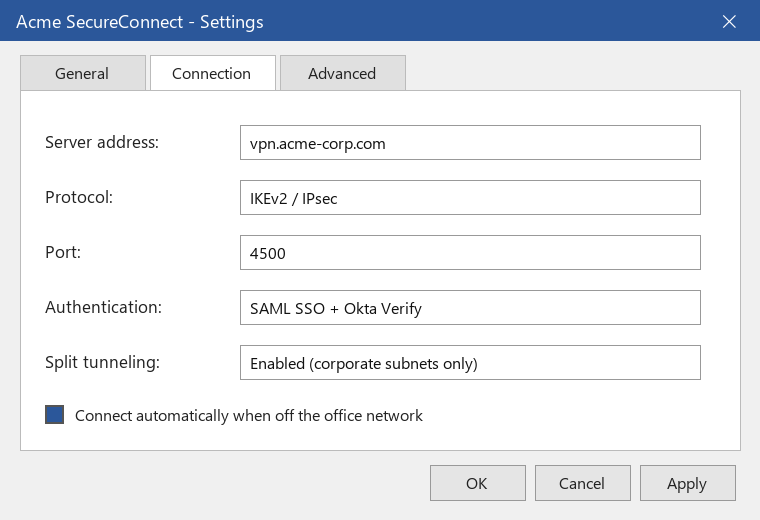

# Connecting to VPN

_Manual pages not recorded_

Most tools are available directly over the internet through SSO. You need the Acme SecureConnect VPN only for internal tools such as the build servers, the finance data warehouse and staging environments. SecureConnect is pre-installed on your laptop; the correct settings are shown below.

Image path: images/page_000_img2.png

Image description: Figure 2: SecureConnect connection settings

*Figure 2: SecureConnect connection settings*

| Setting | Value |
| --- | --- |
| Server address | vpn.acme-corp.com |
| Protocol | IKEv2 / IPsec |
| Port | 4500 |
| Authentication | SAML SSO + Okta Verify |
| Split tunneling | Enabled (corporate subnets only) |
