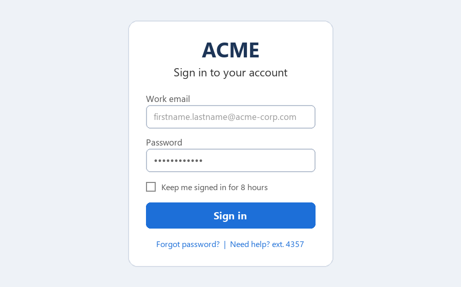

# Signing In

_Manual pages not recorded_

All Acme applications use single sign-on (SSO). The sign-in page looks like the screenshot below. Always check that the address bar shows **login.acme-corp.com** before entering your password.

Image path: images/page_000_img1.png

Image description: Figure 1: Acme single sign-on page

*Figure 1: Acme single sign-on page*

1. Open the activation link from your welcome email.
2. Create a password of at least 14 characters. Passphrases are encouraged.
3. Sign in at login.acme-corp.com with firstname.lastname@acme-corp.com.
4. Continue to set up multi-factor authentication (next section).
