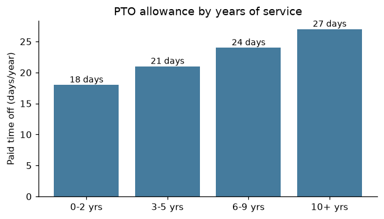

# 3 Working Hours and Leave

_Manual p. 2_

Our core collaboration hours are 10:00 to 15:00 in your local time zone. Outside of those hours, you are free to organize your day as works best for you and your team.

Image path: images/page_002_img1.png

*Figure 2: Paid time off allowance increases with years of service*

| Leave type | Allowance | Notes |
| --- | --- | --- |
| Paid time off (PTO) | 18-27 days/year | Based on tenure; up to 5 days carry over |
| Company holidays | 11 days/year | Published each December |
| Sick leave | 10 days/year | No doctor's note needed for up to 3 consecutive days |
| Parental leave | 16 weeks, fully paid | For all parents, within 12 months of birth or adoption |
| Bereavement | Up to 10 days | Depending on relationship |
| Volunteer day | 2 days/year | For registered non-profits |
