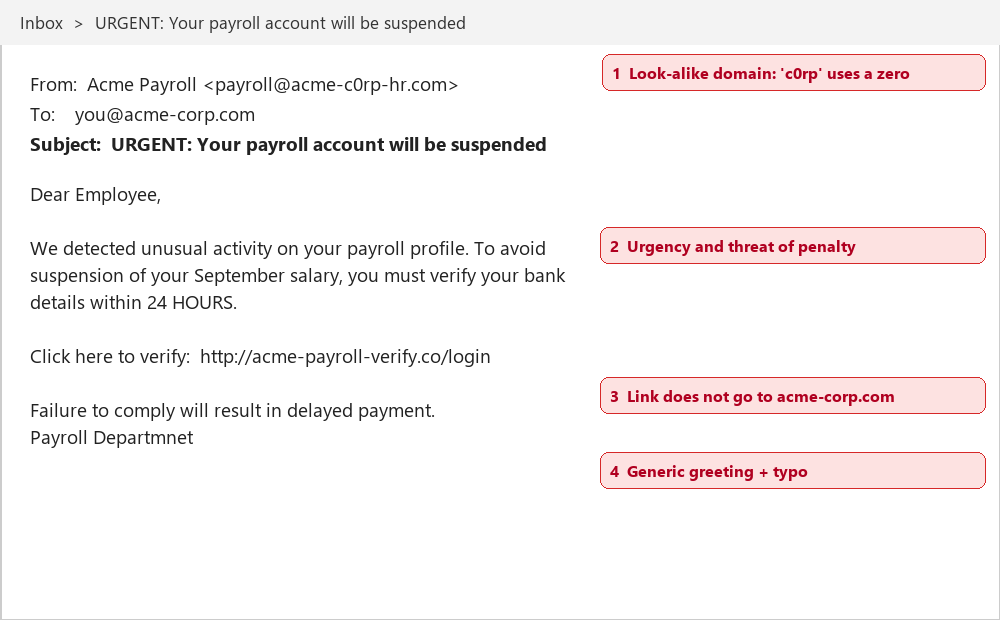

# Anatomy of a Phishing Email

_Manual pages not recorded_

The example below was sent to 40 Acme employees in August 2026. Six people clicked the link; one entered their password before reporting it. The annotations point out the warning signs.

Image path: images/page_000_img1.png

Image description: Figure 1: Annotated phishing email impersonating the payroll team

*Figure 1: Annotated phishing email impersonating the payroll team*

- **Look-alike domain:** acme-c0rp-hr.com uses a zero instead of the letter o.
- **Urgency and threats:** 'within 24 HOURS' and 'delayed payment' are designed to rush you.
- **Suspicious link:** the link goes to acme-payroll-verify.co, not an acme-corp.com address.
- **Generic greeting and typos:** 'Dear Employee' and 'Departmnet'.
