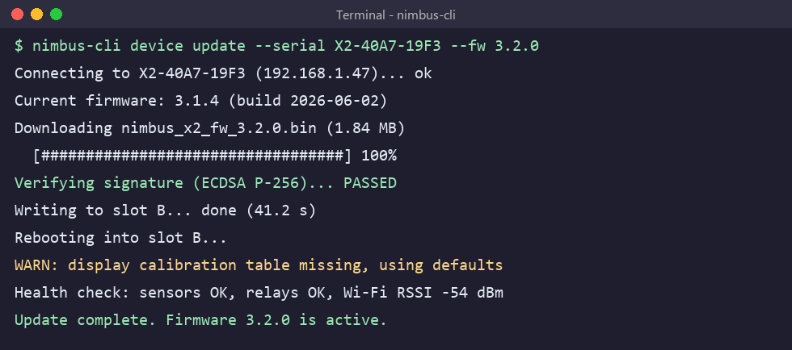

# Upgrade Procedure

_Manual pages not recorded_

Most customers receive the update automatically overnight. Lab and field-test units can be updated manually with the nimbus-cli tool:

1. Connect your computer to the same network as the thermostat.
2. Run **nimbus-cli device update --serial <serial> --fw 3.2.0**.
3. Wait for the device to reboot (about 60 seconds). Do not remove the display during the update.
4. Confirm the version under Menu > Settings > About.

Image path: images/page_000_img2.png

Image description: Figure 2: Example nimbus-cli output for a successful update to 3.2.0

*Figure 2: Example nimbus-cli output for a successful update to 3.2.0*
