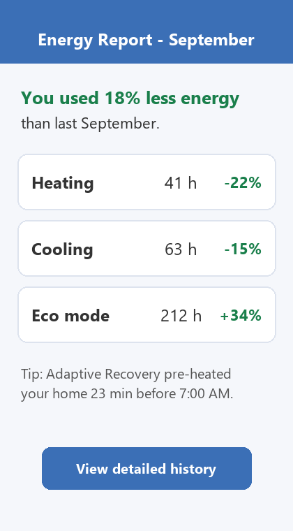

# Energy Reports

_Manual pages not recorded_

On the first day of each month, the app generates an energy report showing heating, cooling and Eco runtime, plus a comparison with the same month last year. Reports require at least 30 days of history.

Image path: images/page_000_img1.png

*Figure 1: Energy report screen in the Nimbus mobile app*
