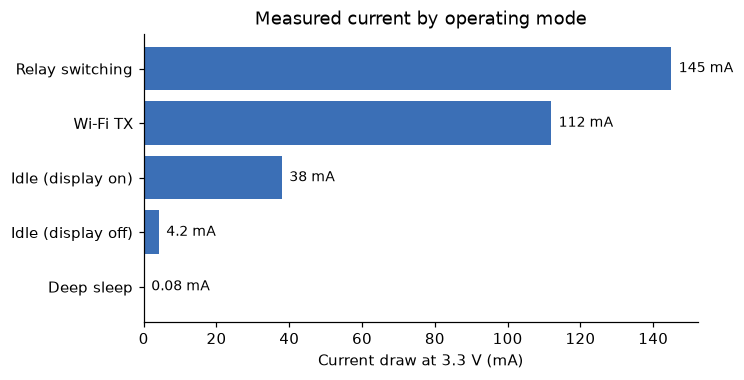

# 3 Power Subsystem

_Manual p. 3_

The thermostat is powered from the 24 VAC R and C terminals through a full-bridge rectifier and a synchronous buck converter. When no C wire is present, the power-stealing circuit draws current through the W or Y call circuit while the relay is open, charging a 1 F supercapacitor that buffers the peak load during Wi-Fi transmission.

| Rail | Voltage | Max current | Source | Loads |
| --- | --- | --- | --- | --- |
| VIN | 24 VAC (18-30 VAC) | 250 mA | HVAC transformer | Rectifier input |
| V5 | 5.0 V | 400 mA | Buck converter | Relay coils, 3.3 V LDO |
| V3P3 | 3.3 V | 300 mA | LDO | MCU, radio, sensors, display logic |
| VBL | 12 V | 40 mA | Boost converter | Display backlight |

Image path: images/page_003_img1.png

*Figure 2: Measured 3.3 V current draw in each operating mode*

Peak current occurs when a relay is switching while Wi-Fi is transmitting. Firmware staggers these events by at least 50 ms so that power-stealing installations do not brown out.
