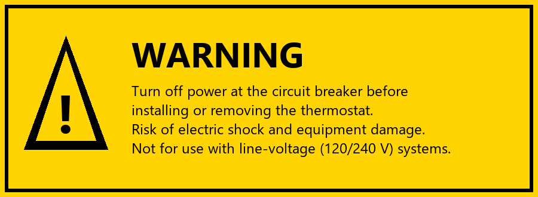

# 1 Safety Information

_Manual p. 1_

The Nimbus X2 is designed for 24 V low-voltage heating and cooling systems only. Improper installation can damage your equipment or cause injury. If you are not comfortable working with household wiring, contact a licensed HVAC professional.

Image path: images/page_001_img2.png

*Figure 1: Warning label printed on the back of the X2 backplate*

- Do not connect to 120 V or 240 V line-voltage heating systems (for example baseboard heaters).
- Do not install in bathrooms or other locations where the unit may get wet.
- Keep the thermostat away from direct sunlight, drafts and heat sources such as lamps.
