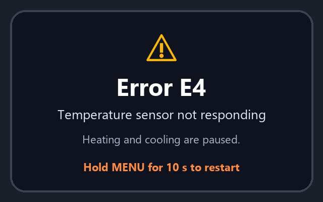

# 5 Troubleshooting

_Manual p. 4_

If X2 detects a problem it shows an error code on screen and sends a notification to the Nimbus app. Heating and cooling may pause until the problem is resolved.

Image path: images/page_004_img1.png

*Figure 4: Example error screen for code E4*

| Code | Meaning | What to do |
| --- | --- | --- |
| E1 | No power on R wire | Check the breaker and the R wire connection |
| E2 | Power stealing unstable | Install the PAK-2 adapter or connect a C wire |
| E3 | Wi-Fi authentication failed | Re-enter the Wi-Fi password in the app |
| E4 | Temperature sensor not responding | Hold MENU for 10 s to restart; contact support if it returns |
| E5 | Relay stuck | Turn off power at breaker and contact support |
| E6 | Firmware image invalid | Device will roll back automatically; retry update later |
