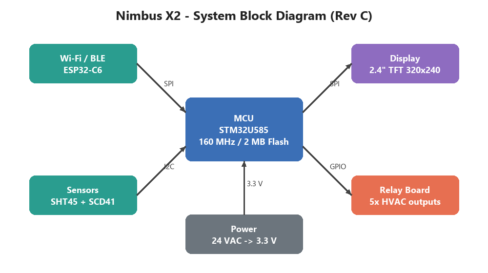

# 2 System Architecture

_Manual pp. 1–2_

The architecture is centered on a single STM32U585 microcontroller that handles the user interface, control loop and sensor fusion. A separate ESP32-C6 module provides Wi-Fi and BLE connectivity and communicates with the MCU over SPI. The block diagram below shows the main functional blocks and the buses that connect them.

Image path: images/page_001_img1.png

Image description: Figure 1: System block diagram showing MCU, radio, sensors, display, relay board and power interfaces

*Figure 1: System block diagram showing MCU, radio, sensors, display, relay board and power interfaces*

The relay board is isolated from the main board by optocouplers so that a fault on the HVAC side cannot damage the MCU. All high-current traces are routed on the relay board only.
