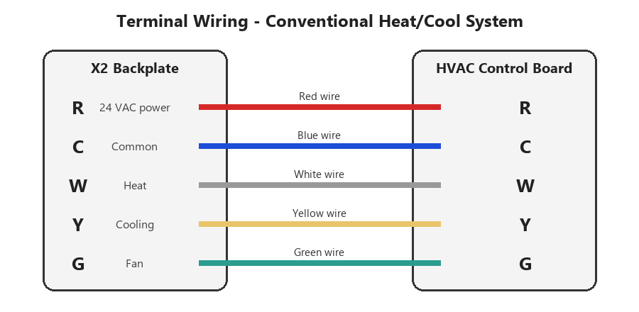

# 3.1 Wiring

_Manual p. 2_

Before removing your old thermostat, take a photo of its wiring and use the included stickers to label each wire by the terminal it was connected to. Wire color is not always a reliable indicator; always label by terminal letter.

Image path: images/page_002_img1.png

Image description: Figure 2: Terminal wiring for a conventional heat/cool system with fan

*Figure 2: Terminal wiring for a conventional heat/cool system with fan*

| Terminal | Typical color | Function | Required? |
| --- | --- | --- | --- |
| R / Rh / Rc | Red | 24 VAC power from transformer | Yes |
| C | Blue or black | Common (return path for 24 VAC) | Recommended |
| W / W1 | White | Heat stage 1 | If you have heating |
| Y / Y1 | Yellow | Cooling stage 1 (or compressor for heat pumps) | If you have cooling |
| G | Green | Fan | Recommended |
| O/B | Orange or dark blue | Heat pump reversing valve | Heat pumps only |
