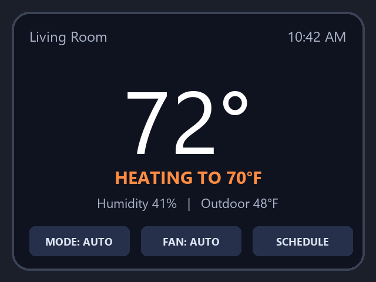

# 4 Using Your Thermostat

_Manual pp. 3–4_

After power-up, X2 guides you through setup on screen and in the Nimbus app. The home screen shows the current indoor temperature in large digits, the target temperature and what the system is doing right now.

Image path: images/page_003_img1.png

Image description: Figure 3: X2 home screen while heating

*Figure 3: X2 home screen while heating*

Turn the outer ring to change the target temperature and press the display to open the menu. The three buttons at the bottom of the screen open the mode, fan and schedule settings.
