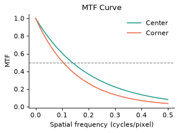

# Image Quality Metrics

_Manual pp. 3–4_

| Test | Result | Target | Notes |
| --- | --- | --- | --- |
| MTF50 (center) | 0.42 cycles/pixel | >= 0.38 | Pass |
| MTF50 (corner) | 0.31 cycles/pixel | >= 0.28 | Pass |
| SNR @ 1000 lux | 38.1 dB | >= 36 dB | Pass |
| Distortion | 1.2% | <= 1.0% | Fail |
| Color accuracy (dE2000) | 3.4 | <= 4.0 | Pass |

Image path: images/page_003_img1.png

The MTF curve shows a corner fall-off consistent with the lens design, remaining above target.
