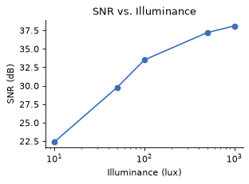

# Background

_Manual pp. 1–2_

The MCN5 sensor is a 50 MP, 1/1.56-inch stacked CMOS sensor intended for mid-range smartphones. It was tested under various lighting conditions ranging from 10 lux (dim indoor) to 1,000 lux (overcast daylight).

Image path: images/page_001_img1.png

Signal-to-noise ratio improves steadily with illuminance and plateaus above 500 lux.
