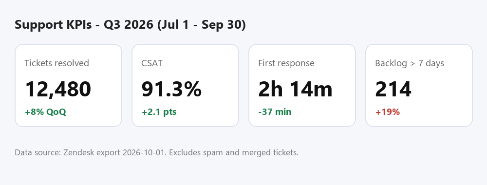

# Key Metrics

_Manual pages not recorded_

Image path: images/page_000_img1.png

Image description: Figure 1: Support KPI dashboard for Q3 2026

*Figure 1: Support KPI dashboard for Q3 2026*

| Metric | Q2 2026 | Q3 2026 | Target | Status |
| --- | --- | --- | --- | --- |
| Tickets resolved | 11,556 | 12,480 | - | - |
| CSAT | 89.2% | 91.3% | 90% | On track |
| First response time (median) | 2h 51m | 2h 14m | 2h 30m | On track |
| First contact resolution | 58% | 61% | 65% | Behind |
| Backlog > 7 days | 180 | 214 | < 150 | At risk |
