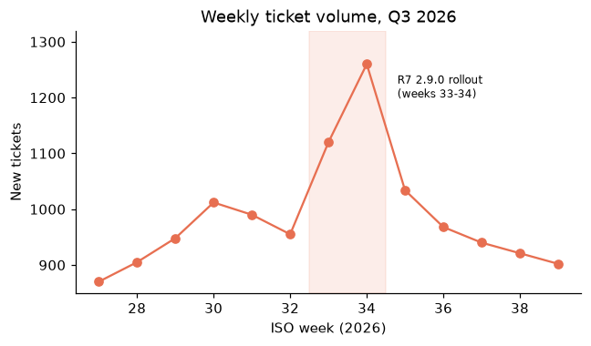

# Ticket Volume

_Manual pages not recorded_

Weekly volume rose from 870 tickets at the start of the quarter to a peak of 1,260 in week 34, when R7 firmware 2.9.0 was rolled out to all customers. Most of the extra contacts were about failed updates (error E-217) and a 5 GHz speed regression, both fixed in 2.9.1.

Image path: images/page_000_img2.png

Image description: Figure 2: Weekly new tickets in Q3 2026

*Figure 2: Weekly new tickets in Q3 2026*
