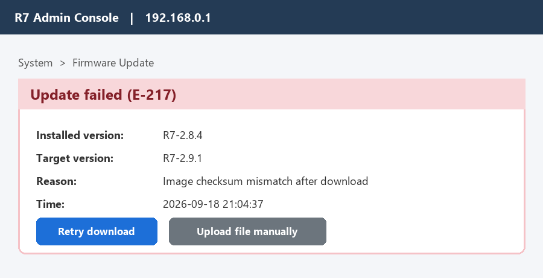

# 4.3 Firmware Update Failure

_Manual p. 3_

Error E-217 means the downloaded firmware image did not pass its checksum check, usually because the download was interrupted. The router keeps running the old firmware, so it is safe.

Image path: images/page_003_img1.png

Image description: Figure 3: Admin Console showing firmware update error E-217

*Figure 3: Admin Console showing firmware update error E-217*

Ask the customer to click **Retry download**. If it fails twice, send them the direct download link from KA-0388 and walk them through **Upload file manually**. Do not ask customers to factory reset for this error.
