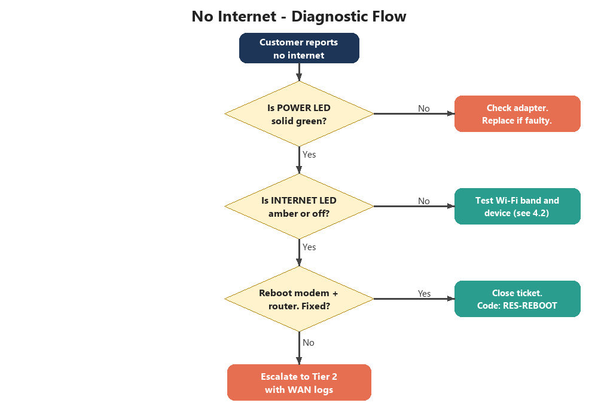

# 3 Diagnostic Flow

_Manual pp. 1–2_

Use this flow for any 'no internet' contact. It resolves about 64% of these tickets without escalation.

Image path: images/page_001_img2.png

Image description: Figure 2: No-internet diagnostic flowchart

*Figure 2: No-internet diagnostic flowchart*

When closing a ticket, always use the resolution code shown in the flowchart so that reporting stays accurate.
