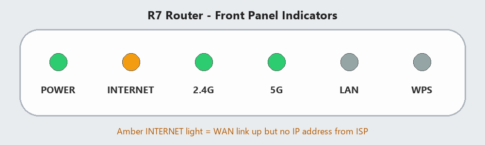

# 2 LED Status Reference

_Manual p. 1_

The front panel LEDs are the fastest way to narrow down a problem. Ask the customer to describe the color and whether each light is solid or blinking.

Image path: images/page_001_img1.png

Image description: Figure 1: R7 front panel with an amber INTERNET indicator

*Figure 1: R7 front panel with an amber INTERNET indicator*

| LED | Solid green | Blinking green | Amber | Off |
| --- | --- | --- | --- | --- |
| POWER | Normal | Booting / updating | Hardware fault | No power |
| INTERNET | Online | Traffic | WAN up, no IP from ISP | No WAN cable |
| 2.4G / 5G | Radio on | Traffic | Radio error | Radio disabled |
| LAN | Device connected | Traffic | - | No device |
| WPS | Paired | Pairing (2 min) | Pairing failed | Idle |
