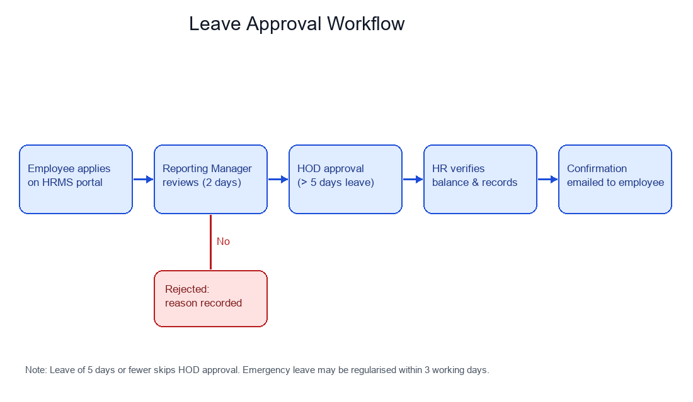

# Leave Approval Procedure

_Manual pages not recorded_

1. The employee submits a leave request on the HRMS portal with dates, leave type and reason.
2. The reporting manager approves or rejects within 2 working days; unactioned requests auto-escalate to the HOD.
3. Requests longer than 5 working days also require HOD approval.
4. HR verifies leave balance and updates attendance records.
5. The employee receives an email confirmation.

Emergency leave taken without prior approval must be regularised within 3 working days of returning to work.

Image path: images/page_000_img4.png

Image description: GLOBAL SCENE: A horizontal flowchart titled 'Leave Approval Workflow' on a white background showing five rounded blue boxes connected left-to-right by arrows. KEY OBJECTS: Steps read 'Employee applies on HRMS portal', 'Reporting Manager reviews (2 days)', 'HOD approval (> 5 days leave)', 'HR verifies balance & records', and 'Confirmation emailed to employee'; a red box below the manager step labelled 'Rejected: reason recorded' is connected by a downward 'No' arrow. TEXT & LABELS: Footer note reads 'Leave of 5 days or fewer skips HOD approval. Emergency leave may be regularised within 3 working days.'
