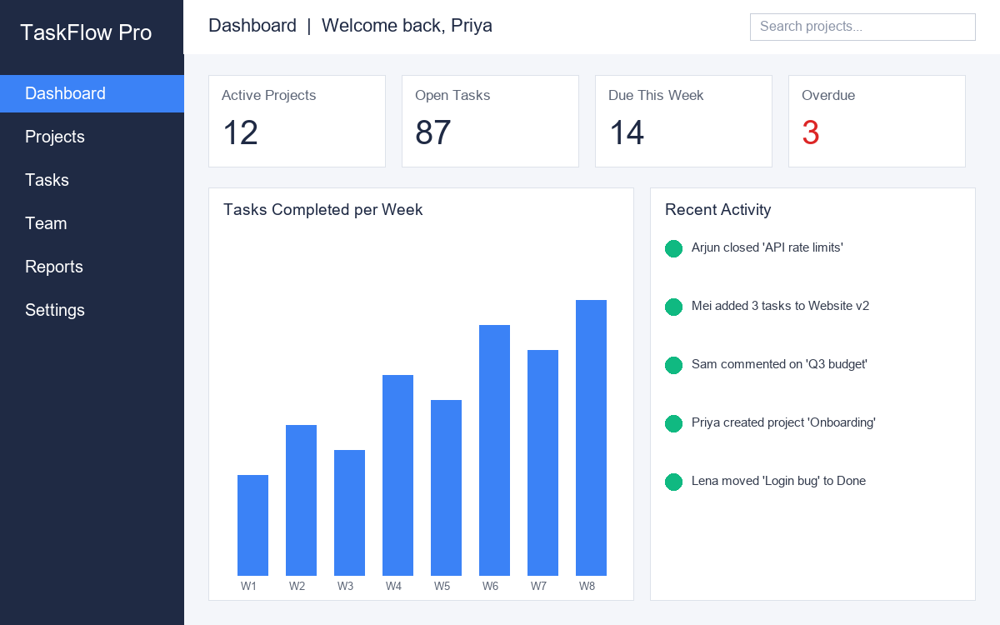

# Dashboard

_Manual pages not recorded_

## Overview

The dashboard is the first screen you see after signing in. It contains:

- **KPI cards** - Active Projects, Open Tasks, Due This Week, and Overdue (highlighted red when greater than zero).
- **Tasks Completed per Week** - a bar chart covering the last eight weeks.
- **Recent Activity** - the latest updates from projects you belong to.

Click any KPI card to open a filtered task list. Widgets can be rearranged by dragging their title bar.

Image path: images/page_000_img1.png

Image description: GLOBAL SCENE: A desktop web application screenshot of the TaskFlow Pro dashboard with a dark navy left sidebar and a light grey main canvas. KEY OBJECTS: Four white KPI cards across the top read Active Projects 12, Open Tasks 87, Due This Week 14 and Overdue 3 (the last in red); below them a blue bar chart titled 'Tasks Completed per Week' rises from W1 to W8, and a 'Recent Activity' feed lists five team actions with green status dots. TEXT & LABELS: Sidebar items Dashboard (highlighted blue), Projects, Tasks, Team, Reports, Settings; header reads 'Welcome back, Priya' with a 'Search projects...' box at top right.

## Navigation

The left sidebar provides access to Dashboard, Projects, Tasks, Team, Reports and Settings. Collapse it with the `<<` control at the bottom.

Keyboard shortcuts:

| Shortcut | Action |
|---|---|
| Ctrl+K | Open global search |
| G then P | Go to Projects |
| G then D | Go to Dashboard |
| N | New task in current project |
| ? | Show all shortcuts |
