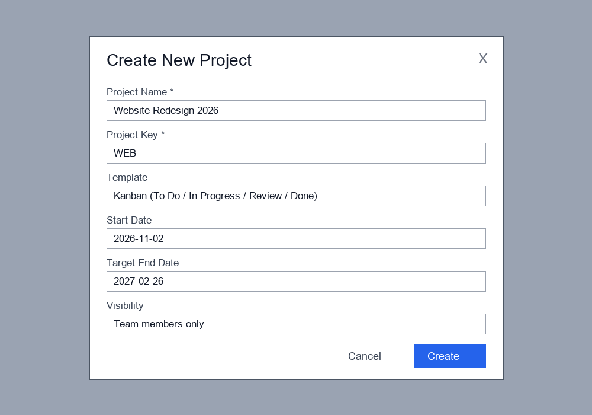

# Project Management

_Manual pages not recorded_

## Creating a Project

1. Go to **Projects** and click **New Project**.
2. Enter a **Project Name** and a 2-6 letter **Project Key** (used as a task prefix, e.g. WEB-142).
3. Choose a **Template**: Kanban, Scrum, Waterfall, or Blank.
4. Set the **Start Date** and **Target End Date**.
5. Choose **Visibility**: Team members only, Entire workspace, or Private.
6. Click **Create**.

The project key cannot be changed after creation.

Image path: images/page_000_img2.png

Image description: GLOBAL SCENE: A modal dialog titled 'Create New Project' overlaid on a dimmed grey background. KEY OBJECTS: Six stacked labelled input fields and two buttons at the bottom right — an outlined 'Cancel' and a solid blue 'Create'; a close 'X' sits in the top-right corner. TEXT & LABELS: Project Name * 'Website Redesign 2026', Project Key * 'WEB', Template 'Kanban (To Do / In Progress / Review / Done)', Start Date '2026-11-02', Target End Date '2027-02-26', Visibility 'Team members only'.

## Adding Team Members

Open the project, select **Members > Invite**, and enter one or more email addresses. Each member receives a role:

| Role | Permissions |
|---|---|
| Owner | Full control including deleting the project |
| Manager | Edit project settings, manage members and sprints |
| Contributor | Create, edit and comment on tasks |
| Viewer | Read-only access |

Invitations expire after 7 days. Guests outside your domain count toward the guest seat limit.

## Task Assignment

Open a task and choose a person in the **Assignee** field, or drag a task card onto a team member's avatar on the board. A task can have one assignee and any number of watchers. Set **Estimate** in hours or story points and a **Due Date**.

The **Workload** view shows allocated hours per person per week; members above 40 hours are flagged in orange.
