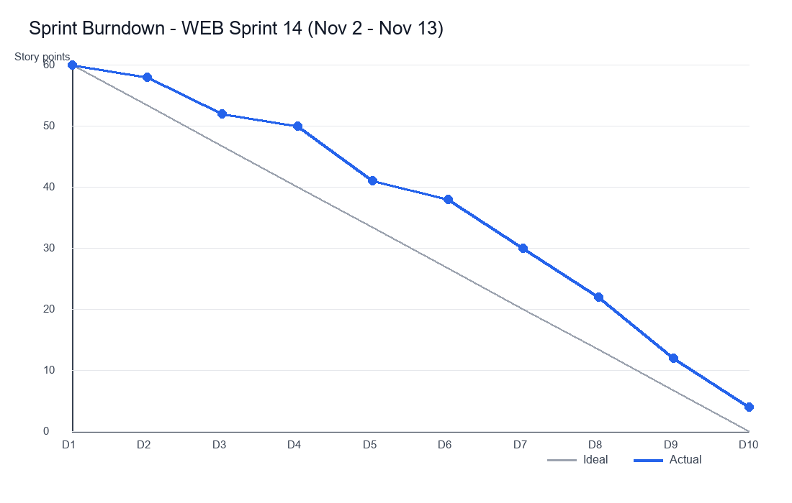

# Reports

_Manual pages not recorded_

Built-in reports are available under **Reports**:

- **Sprint Burndown** - remaining story points against the ideal line.
- **Velocity** - points completed per sprint for the last 10 sprints.
- **Time Tracking** - logged hours by person, project and week.
- **Overdue Tasks** - all tasks past due, grouped by assignee.

Every report can be exported to PDF or CSV and scheduled for weekly email delivery.

Image path: images/page_000_img3.png

Image description: GLOBAL SCENE: A line chart report titled 'Sprint Burndown - WEB Sprint 14 (Nov 2 - Nov 13)' on a white background. KEY OBJECTS: A grey diagonal 'Ideal' line falls from 60 to 0 story points across days D1-D10, while a blue 'Actual' line with circular markers stays above ideal mid-sprint (plateau around D3-D4 at 52-50 points) before dropping steeply to 4 points on D10. TEXT & LABELS: Y-axis 'Story points' with ticks 0-60 in steps of 10; X-axis D1 through D10; legend at bottom right reads Ideal and Actual.
