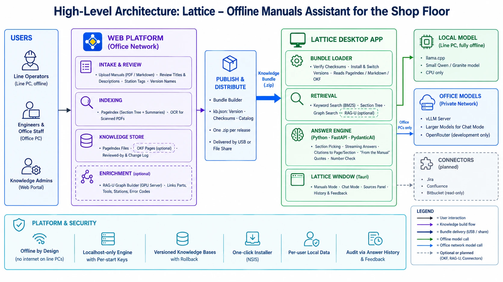
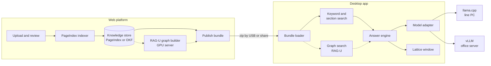
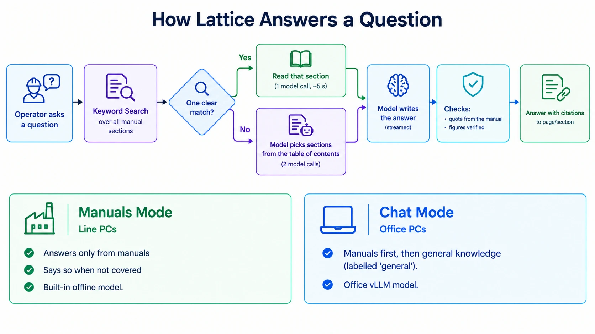
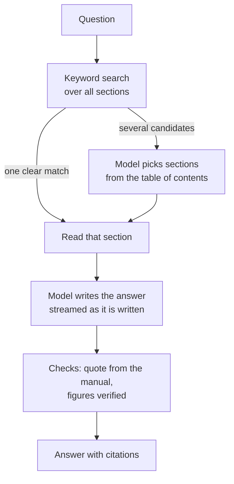

# Lattice: project plan to October 15

Sep 24, 2026 · @Abhi

Lattice (previously called Oasis) is an assistant that answers questions from the plant's manuals, with the page or section each answer came from. By Oct 15, 2026 both parts, the web platform and the desktop app, reach a release candidate.

The design is not fixed yet. The architecture below has two open slots: OKF for how knowledge is stored, and RAG-U for how it is searched. We fix the design by Oct 7, 2026.

## The two parts

The web platform turns manuals into a knowledge base. The desktop app answers questions from it, fully offline on the line.

| Part | Who builds it | Runs where | What it does |
| --- | --- | --- | --- |
| Web platform | Web team | Office network, online | Takes uploaded manuals (PDF, Markdown), indexes them with PageIndex, lets an admin review titles, summaries and station tags, then publishes one versioned bundle (.zip). |
| Desktop app | Desktop team | Line machine (offline) and office PCs | Imports the bundle, finds the right section, and answers with citations. It uses a small built-in model on the line, or a network model (vLLM or OpenRouter) in the office. |

The bundle is the only contract between the two teams. Its format is written down in `docs/kb-bundle-spec.md`, so each side can work and test on its own.

## System architecture

Lattice is built in layers, so each one can change without touching the others. Solid lines exist today. Dashed lines are the open slots where OKF and RAG-U can plug in.

Line machines stay offline: everything they need arrives in the bundle. Office PCs can also reach a vLLM server on the network.

| Layer | Component | Job | Today | Open slot |
| --- | --- | --- | --- | --- |
| Web: intake | Upload and review screens | Admin adds manuals and fixes titles, descriptions and station tags | Planned | None |
| Web: indexing | PageIndex | Splits each manual into sections with short summaries | Working | None |
| Web: storage | Knowledge store | Holds the indexed manuals between releases | PageIndex files | **OKF** as the storage format |
| Web: enrichment | Graph builder | Links parts, tools, stations and error codes across manuals | None | **RAG-U** |
| Web: publishing | Bundle builder | Writes `kb.json` (version, checksums, catalog) and zips everything | Working | None |
| Desktop: loading | Bundle loader | Checks, installs and switches bundle versions | PageIndex and Markdown | **OKF** reader |
| Desktop: retrieval | Search | Finds the sections for a question | Keywords (BM25) plus the section tree | **RAG-U** graph search |
| Desktop: answering | Answer engine (Python, FastAPI, PydanticAI) | Picks sections, writes the answer, adds the manual's quote, checks figures | Working | None |
| Desktop: models | Model adapter | Talks to any OpenAI-compatible model server | llama.cpp, vLLM, OpenRouter | None |
| Desktop: screen | Lattice window (Tauri) | Ask screen, Manuals/Chat switch, sources, history, settings | Working | None |
| Later | Connectors | Read Jira and Confluence for Chat mode | None | After Oct 15 |

## How a question is answered

Manuals mode answers only from the manuals and says so when they don't cover a question. Chat mode also checks the manuals first, but can answer general questions, marked as general.

A clear match needs one model call (4 to 9 seconds on the built-in 0.8B test model). Otherwise it takes two (about 16 seconds).

|  | Manuals mode | Chat mode |
| --- | --- | --- |
| Answers from | Manuals only | Manuals first, then general knowledge |
| Not in the manuals | Says so | Answers, labelled "general" |
| Model | Built-in, offline | Network model (vLLM in the office) |
| Used on | Line machines | Office PCs |
| Follow-up questions | Rewritten into a full question before searching | Uses the conversation directly |

## Schedule to October 15

Three weeks, four checkpoints. OKF and RAG-U are explored alongside the main work in the first two weeks, and the design is fixed on October 7. Whatever is not ready by then moves after October 15, without delaying the release.

| Dates | Web platform | Desktop app | OKF and RAG-U | Checkpoint |
| --- | --- | --- | --- | --- |
| Sep 24 – 30 | Upload and PageIndex indexing on real plant manuals. Bundle export that passes the spec checks. | Install the current build. Compare models on the real line PC: Qwen3.5-4B, Granite 4.2 3B, Qwen3.5-2B. Start a test set of 50 real questions with the expected answer and section. | OKF: convert 2 manuals and load them in Lattice. RAG-U: set it up on a GPU machine and build a graph of the sample manuals. | Sep 30, 2026 First real bundle imported on the desktop; model chosen. |
| Oct 1 – 7 | Review screens: titles, descriptions, station tags, section summaries. Version names and a Publish button. | Run the test set with the chosen model and fix what fails. Connect Chat mode to an office vLLM server. | Run the test set against both, focusing on questions that span several manuals. Write up the results and the effort for each option. | Oct 7, 2026 Design fixed: option A, B, C or D. |
| Oct 8 – 12 | Build the bundle for the pilot line, in OKF if chosen. Start the graph builder if RAG-U is chosen. | Add the OKF reader or the graph search tool if chosen. Install on one line machine; a short trial with 3 to 5 operators. | Finish the chosen parts; write down what moves after Oct 15. | Oct 12, 2026 Pilot running on one line. |
| Oct 13 – 15 | Fix issues from the pilot. Freeze the bundle format. | Fix issues from the pilot. Build the installer; test the upgrade path. | None | Oct 15, 2026 Release candidate: publish, carry over, import and answer, end to end. |

Carried past Oct 15: connectors for Jira and Confluence (read-only), more languages, asking a clarifying question when a question is unclear, and any OKF or RAG-U parts not finished.

## OKF: Open Knowledge Format

OKF can fill the storage slot: the web platform keeps the knowledge base as OKF, and the desktop app reads it. It is close to the Markdown format Lattice already supports, so it is cheap to adopt.

**What it is.** An open format from Google (v0.1 in June 2026, now v0.2) for knowledge that AI agents read. A knowledge base is a folder of Markdown files, each starting with a small YAML header. Only the `type` field is required. `title`, `description`, `tags`, `sources`, `status`, `stale_after`, and `generated` / `verified` (who made or checked the page, and when) are optional. The optional `index.md` lists the pages, and `log.md` records what changed.

**How it maps to Lattice:**

| OKF field | Use in Lattice |
| --- | --- |
| `title`, `description` | Manual name and the one-line description the model reads |
| `tags` | Station filter on the desktop |
| `verified` | Shows "reviewed by a person" on answers from checked pages |
| `status: deprecated`, `stale_after` | Hide old procedures, or warn that a page may be out of date |
| `sources` | Link to the original PDF page |
| `log.md` | "What changed in this version" after an import |

**What it does not cover.** OKF has no version names or checksums, so `kb.json` and the zip stay. OKF would become a third content type (`source_format: "okf"`) next to PageIndex and Markdown.

**How we would use it:**

1. PageIndex still reads the PDFs. The web platform then writes one OKF page per manual section, with the section summary as `description` and the page numbers in `sources`.
2. Reviewers mark checked pages as `verified`, and `log.md` lists what changed in each release.
3. The bundle keeps `kb.json` and adds `source_format: "okf"`. The desktop app reads it with a small addition to its Markdown reader, about 2 days of work.
4. First step: convert 2 manuals and check that answers match the PageIndex version.

**Upside later:** the same knowledge base could feed other agents, such as the planned Jira and Confluence connectors, without converting it.

## RAG-U: graph-based retrieval

RAG-U can fill the search slot for questions that span several manuals. The graph is built on the web platform and searched in office Chat mode. Line machines keep today's lighter search.

**What it is.** RAGU ("Retrieval-Augmented Graph Utility") is an open-source Python library under the MIT license, described in a July 2026 paper. It uses a model to pull things and their links out of the documents, for example "torque tool DT-450 is used at station 4". It then merges duplicates and groups related things into topics with summaries. It can search in four ways: nearby facts, topic summaries, plain text chunks, or a mix of these. It works with any OpenAI-compatible model server, including vLLM. Its authors built a 7B model for the extraction step that runs on one GPU.

**Where it would fit:**

| Step | Where | Why there |
| --- | --- | --- |
| Build the graph | Web platform, GPU server | Thousands of model calls per manual; not possible on a line PC |
| Ship the graph | In the bundle, next to the PageIndex content | Desktop stays offline |
| Search the graph | Office Chat mode, as an extra tool beside the manuals search | Needs a larger model and embeddings, which office servers have |
| Line machines | Unchanged: keyword search plus section reading | Small model, CPU only |

**Good for:** "Which stations use the DT-450?", "Which errors point to low air pressure?" Our current search finds one section at a time and struggles with these.

**Watch out for:**

- Its answers come from model-made summaries, not the manual's own words. We must keep page citations and the "From the manual" quote.
- A model writes the graph, so it can contain mistakes. Safety-related answers must still come from the manual text.
- The project is young, and its tuned model targets English and Russian.

**How we would use it:**

1. After indexing, a GPU server runs RAGU over the manuals, pointed at an office vLLM model. If we adopt OKF, the links between OKF pages give the graph a head start.
2. The graph ships inside the bundle, next to the manuals.
3. In Chat mode, Lattice gets a third tool, "search connections", next to "search manuals" and "read section". Every answer still cites and quotes the manual pages.
4. First step: index the real manuals and compare answers on the cross-manual questions from the test set.

## Four ways to combine them

Both slots are independent, so any mix works. Option D gets the most out of both; option A needs no new work and is always the fallback.

| Option | Storage | Search | Gains | Extra work |
| --- | --- | --- | --- | --- |
| A. Today | PageIndex files | Keywords and sections | Already working | None |
| B. OKF only | OKF pages | Keywords and sections | Reviewed-by and out-of-date markers; knowledge usable by other tools | OKF export on the web; OKF reader on the desktop (about 2 days) |
| C. RAG-U only | PageIndex files | Adds graph search in Chat mode | Answers that span several manuals | GPU server, graph builder, new Chat tool |
| D. OKF and RAG-U | OKF pages | Adds graph search in Chat mode | Both of the above; OKF links feed the graph | B and C together |

We pick one on October 7, using the results of the first steps described in each section.

## Risks and open questions

The biggest risk is answer quality on the line PC's CPU. The test set and the model comparison in week 1 are there to catch it early.

| Risk | If it happens |
| --- | --- |
| The chosen model is too slow or too weak on the line PC | Use Qwen3.5-2B for speed, or connect the line to an office vLLM server where the network allows it |
| Real manuals are scanned PDFs with no text | The web platform runs OCR before indexing |
| The web platform's review screens slip | Publish the first bundle from the command line with the existing bundle builder |
| OKF or RAG-U work is not finished by October 12 | Release on option A (today's path) and ship the unfinished parts in the next release |

- [ ] Is "RAG-U" the RAGU library (RaguTeam) described above, or another tool we were told about?
- [ ] Which line runs the pilot, and which 3 to 5 operators take part?
- [ ] Is there a GPU machine for the RAG-U trial, and an office vLLM server for Chat mode?
- [ ] Who writes the 50 test questions: line engineers or the web team?
- [ ] Do the manuals need languages other than English?

## Sources

- [How the Open Knowledge Format can improve data sharing](https://cloud.google.com/blog/products/data-analytics/how-the-open-knowledge-format-can-improve-data-sharing), Google Cloud blog
- [OKF specification, SPEC.md (v0.2)](https://github.com/GoogleCloudPlatform/open-knowledge-format/blob/main/SPEC.md), GitHub
- [OKF in knowledge-catalog (earlier snapshot)](https://github.com/GoogleCloudPlatform/knowledge-catalog/tree/main/okf), GitHub
- [RAGU: A Multi-Step GraphRAG Engine with a Compact Domain-Adapted LLM](https://arxiv.org/abs/2607.11683), arXiv
- [RaguTeam/RAGU](https://github.com/RaguTeam/RAGU), GitHub
- Lattice repository (still named oasis): `docs/kb-bundle-spec.md` (bundle format), `docs/deployment.md` (installing, office models)
